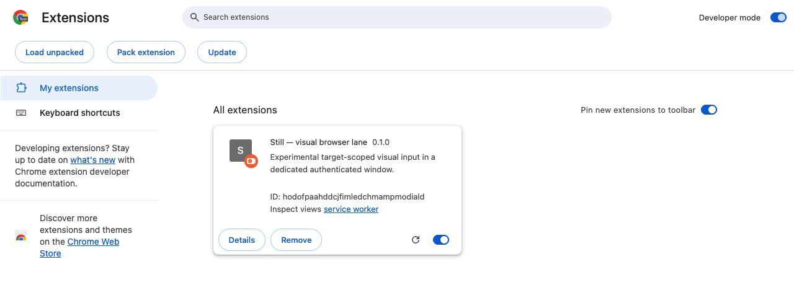
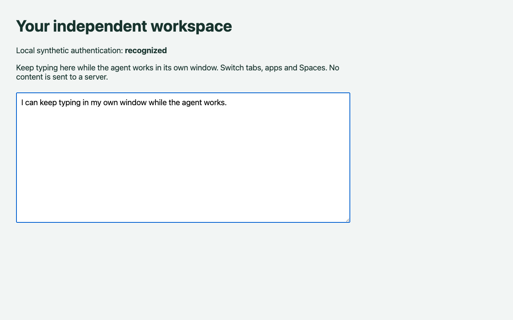
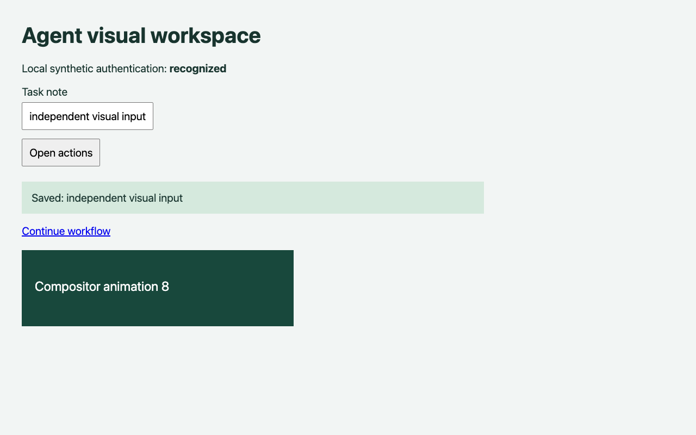

# Still

**Keep using your logged-in Chrome while an AI agent works in its own visual lane.**

Still is a Chrome extension and local MCP server. It gives the agent a separate
interaction surface inside your existing Chrome profile: real screenshots, clicks,
scrolling and typing, with no profile copy or cookie export.


**Experimental, with a working tested path.** Normal Chrome 157 passed a visual
workflow, an existing Google sign-in check and 138 workflow rounds / 2,208 tool calls
in 120.7 seconds. The human confirmed active Chrome use without interference during
that run. Native dialogs, popups, individual Space transitions and arbitrary sites
are not universally isolated. [Read the evidence and failures.](docs/EVIDENCE.md)

## Use Still if it is already installed

1. Leave the **Still agent lane** window open, **unminimized and unfocused**. Work in
   your usual Chrome window. The agent lane is an ordinary separate window; it is not
   an invisible desktop.
2. Start a **fresh Codex conversation** with the Still MCP server enabled.
3. Paste a task such as:

   ```text
   Use $still-browser. Open https://www.google.com and search for
   “Chrome DevTools Protocol”. Use Still lane tools and screenshots only.
   Show me the result, then close your owned tab.
   ```

The bundled skill teaches the agent the product and its operating rules. If you
installed only the extension/MCP server, install the skill from this checkout:

```sh
node scripts/install-skill.mjs
```

That installs a copy in your Codex skills directory (`~/.codex/skills/still-browser`
by default). It refuses to overwrite an existing skill. For another skills-compatible
agent, pass its destination directory explicitly or copy the
[skill folder](skills/still-browser). The skill needs the Still MCP tools; it does
not create a browser connection by itself.

**If the agent cannot see `lane_*` tools:** the current conversation does not have
Still available. Check `codex mcp get still` and start a fresh conversation with that
server enabled. Do not switch to native Computer Use as a fallback for this task.

## First-time installation

You need **macOS, Google Chrome and Node.js 22+**. The supported integration is MCP;
Still does not replace Codex's native Computer Use backend. Linux and other browser
support remain unverified; Windows is not supported in this build.

### 1. Prepare this checkout and the agent skill

Download or clone this repository, then open a terminal in its root directory:

```sh
npm ci
npm test
node scripts/install-skill.mjs
```

Keep the checkout at this location after installation: the native launcher and MCP
configuration point to its files.

### 2. Load the Chrome extension

In the **Chrome profile where you are already logged in**:

1. Open `chrome://extensions`.
2. Turn on **Developer mode**, at the upper right.
3. Click **Load unpacked**, at the upper left.
4. Select the **`extension/` folder inside this checkout**, not the repository root.
5. Find **Still — visual browser lane** and copy the **ID** on its card.



*Real Chrome for Testing screenshot from a disposable profile. Your extension ID may
be different; copy your own ID, not the one in this image.*

Review the debugger permission before using a real profile. Chrome grants broad
browser access to the extension even though Still exposes a narrow toolset.
Screenshots may contain private information and reach your configured AI provider.

### 3. Register the local browser bridge

Replace the example argument with the 32-character extension ID you just copied:

```sh
node scripts/install-host.mjs YOUR_32_CHARACTER_EXTENSION_ID
```

This registers a Chrome native messaging host that uses an owner-only local Unix socket.
It does not export authentication data or open a debugging TCP port. The installer
refuses existing files; if it reports an existing installation, inspect it before
replacing anything. [Recovery instructions.](docs/TROUBLESHOOTING.md)

### 4. Create the agent lane

Click **Still** in Chrome's toolbar, or open it through the puzzle-piece extensions
menu. Enter the **starting origins** the agent will need, one per line. For example:

```text
https://www.google.com
http://127.0.0.1:8741
```

An origin is the protocol, hostname and port—not a full page path. `localhost` and
`127.0.0.1` are different hostnames for this check.


Click **Create dedicated lane**. You should see a separate Chrome window titled
**Still agent lane**. Keep that window restored and switch back to your own window.
The screenshot above is the real extension UI, populated with example origins.

Starting-origin approval restricts requested navigation; it is **not a network
sandbox**. Page links, redirects and subresources can leave that list.

### 5. Connect Codex to Still

Run these commands from the checkout root. They record absolute paths so the
configuration does not depend on your next terminal's working directory or PATH:

```sh
STILL_NODE="$(node -p 'process.execPath')"
STILL_PROJECT="$(pwd)"
codex mcp add still -- "$STILL_NODE" "$STILL_PROJECT/src/mcp.js"
codex mcp get still
```

The last command should report an enabled **stdio** server named `still` whose
arguments point to `src/mcp.js`. For another MCP client, configure an equivalent
stdio server with your absolute Node and script paths:

```toml
[mcp_servers.still]
command = "/absolute/path/to/node"
args = ["/absolute/path/to/Still/src/mcp.js"]
```

### 6. Start a fresh conversation and try it

Use the prompt in [Use Still if it is already installed](#use-still-if-it-is-already-installed).
You should be able to keep typing, clicking and scrolling in your usual Chrome
window while the agent operates its own tab. If anything steals focus or switches a
Space unexpectedly, record it as a failed isolation test and stop that workflow.

## A visual demo you can repeat

Start the local demo server in a terminal and leave it running:

```sh
node scripts/demo-server.mjs
```

1. In **your own Chrome window**, visit `http://127.0.0.1:8741/seed`. This establishes
   a synthetic localhost HttpOnly session and opens your typing workspace.
2. Ensure `http://127.0.0.1:8741` is included in the lane's setup origins.
3. In a fresh Codex conversation, paste:

   ```text
   Use $still-browser to open http://127.0.0.1:8741/task.
   Confirm the synthetic session is recognized from the screenshot.
   Enter “independent visual input”, open Actions, save the note,
   scroll to the footer, then follow Continue workflow.
   Verify each result from screenshots and close your owned tab when finished.
   ```

4. Keep typing in your workspace, switch tabs, use other apps and change Spaces.
   The agent should operate only in its lane.

| Your workspace | Agent workspace |
|---|---|
| [](docs/images/human-workspace.png) | [](docs/images/agent-workspace.png) |

*Open either image to zoom. These are real demo-page screenshots captured with
synthetic data in a disposable profile. They illustrate the two workspaces; they
are not a recording or measurement of concurrent use. Test results are logged
separately in [EVIDENCE.md](docs/EVIDENCE.md).*

For a scripted two-minute repetition after setup:

```sh
node scripts/concurrency-demo.mjs http://127.0.0.1:8741 120
```

It reports completed tool calls and saves a final screenshot. Human observation is
still required to assess interference. Stop the demo server with **Ctrl+C** when
finished. The [seven-test acceptance protocol](docs/VALIDATION.md) includes keyboard,
pointer, window/Space, authentication, visual workflow, durability and ownership tests.

## Everyday operation

| Situation | What to do |
|---|---|
| Starting a task | Ask for `$still-browser` in a conversation with Still tools available. |
| Finishing a task | The agent calls `lane_close`; the empty lane stays available. |
| Lane focused or minimized | Switch to your own window or restore the lane manually. The agent must not activate it. |
| Adding another website | Finish/close agent sessions, reload Still at `chrome://extensions`, then prepare a fresh lane with the full origin list. Reload loses ownership; manually close only recognizable old Still windows. |
| Agent reports stale frame | Take a fresh screenshot before the next input. |
| Missing host or renderer timeout | Follow [troubleshooting](docs/TROUBLESHOOTING.md); do not copy cookies or switch to desktop input. |
| Native authentication, permission sheet or popup | Stop at that unsupported boundary and hand off as appropriate. |

Still supplies `lane_open`, `lane_screenshot`, `lane_click`, `lane_type`, `lane_key`,
`lane_scroll`, `lane_navigate` and `lane_close`. Each connection owns one tab.
Screenshots are 1100 × 760 pixels at scale 1. Every input consumes its latest
screenshot's frame token. `Tab` is deliberately unavailable after a headed test
showed it could focus browser chrome; click the next field instead. The
[agent skill](skills/still-browser/SKILL.md) gives the complete operating contract.

## What is—and is not—isolated

Still separates the input surface from the authentication store. It avoids OS input
injection and exposes no arbitrary JS, raw CDP, cookie extraction or human-tab
selection. Browser/native prompts and popups remain escape paths. Some sites use
tab-local storage or fresh/device-bound authentication that a new lane tab cannot
inherit. Tabs still share persistent profile storage and server-side account effects.
Read the [security model](SECURITY.md) before using sensitive workflows.

## Development and reproducibility

```sh
npm test
npm run format:check
npx playwright install chromium
npm run test:browser
```

The browser experiment uses a disposable Chrome for Testing profile. It does not
open your normal Chrome profile. For the headed macOS observer:

```sh
mkdir -p artifacts
swiftc experiments/observe-macos.swift -o artifacts/observe-macos
STILL_MCP=1 STILL_HEADED=1 STILL_OBSERVER=artifacts/observe-macos npm run test:browser
```

Headed browser launch/setup is outside the measured workload. `STILL_KEY_PROBE=1`
deliberately reproduces unsafe raw Tab traversal in a disposable test build; do not
use it during normal work. Generated test artifacts stay in ignored `artifacts/`.
Review them before sharing.

Regenerate the four documentation screenshots with:

```sh
node scripts/capture-docs.mjs
```

The generator uses a disposable Chrome for Testing profile and a temporary local demo
server, then removes both. The overview SVG is a diagram, not a screenshot. No
personal browser screenshots or profile data are part of this documentation.

- [Architecture](docs/ARCHITECTURE.md) — ownership, transport, rendering and failures.
- [Research](docs/RESEARCH.md) — seven architectures, Codex reports and prior work.
- [Evidence](docs/EVIDENCE.md) — exact results, failed experiments and limitations.
- [Compatibility](docs/COMPATIBILITY.md), [troubleshooting](docs/TROUBLESHOOTING.md),
  [roadmap](docs/ROADMAP.md) and [contributing](CONTRIBUTING.md).

MIT licensed. No code copied from Agent Lanes or Playwright; dependencies keep their
own licenses. Related work is credited in the research report.
