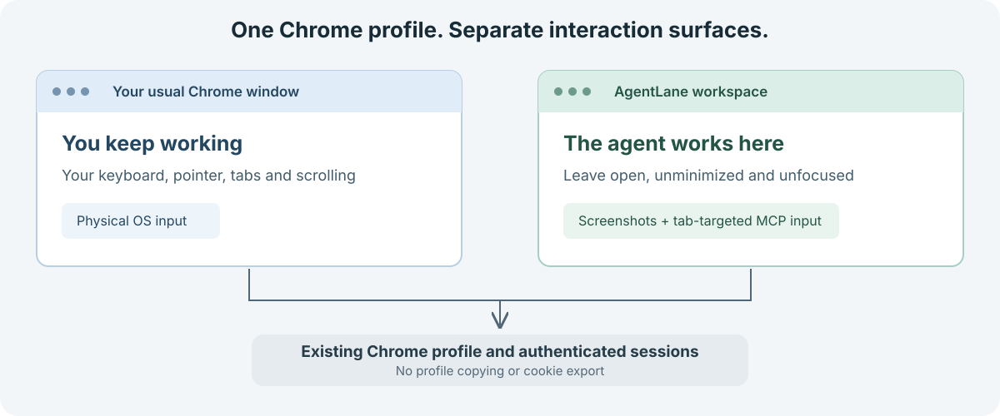
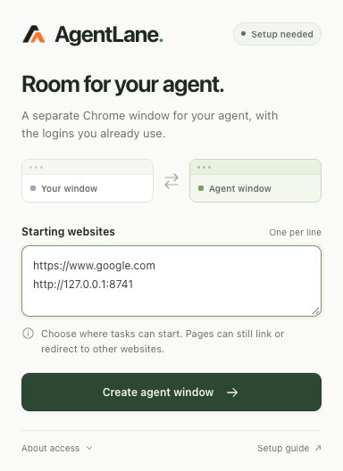
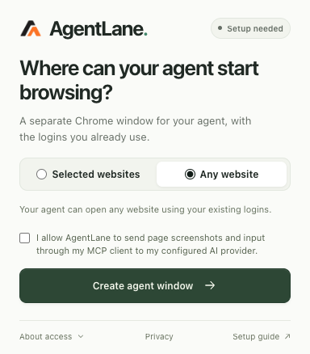
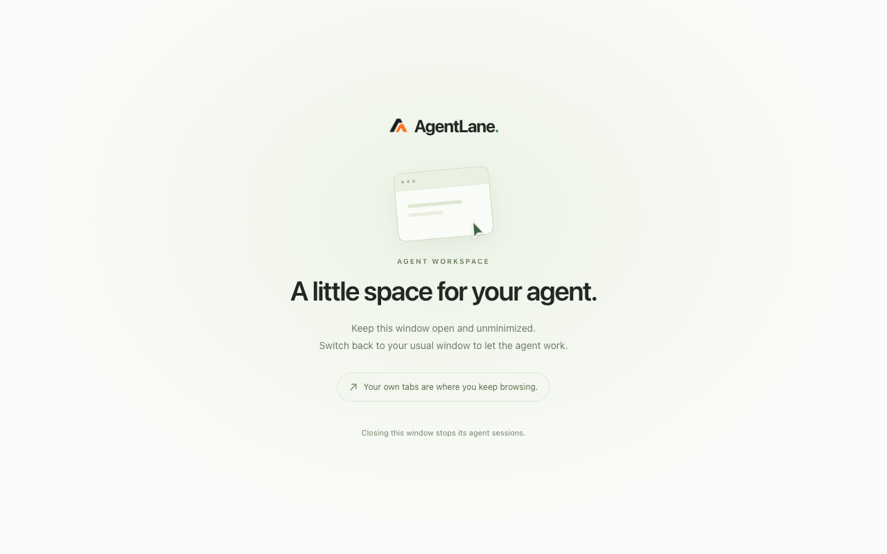

# AgentLane


**Keep using your logged-in Chrome while an AI agent works in its own visual lane.**

**Website and documentation:** open [`index.html`](index.html) (static; served by GitHub Pages) or run `npm run site` and visit <http://localhost:4173>. Check it with `npm run check:site`.

AgentLane is a Chrome extension and local MCP server. It gives the agent a separate
interaction surface inside your existing Chrome profile: real screenshots, clicks,
scrolling and typing, with no profile copy or cookie export.



**Experimental, with a working tested path.** Normal Chrome 157 passed a visual
workflow, an existing Google sign-in check and 138 workflow rounds / 2,208 tool calls
in 120.7 seconds. The human confirmed active Chrome use without interference during
that run. Native dialogs, popups, individual Space transitions and arbitrary sites
are not universally isolated. [Read the evidence and failures.](docs/EVIDENCE.md)

> Upgrading from the former **Still** installation? Follow the [safe migration
> guide](docs/MIGRATION.md). Existing Chrome profiles and authentication stay in place.

## Use AgentLane if it is already installed

1. Leave the **AgentLane workspace** window open, **unminimized and unfocused**. Work in
   your usual Chrome window. The agent lane is an ordinary separate window; it is not
   an invisible desktop.
2. Use a conversation with the AgentLane MCP tools enabled. After first-time
   installation, start a fresh conversation to discover the tools.
3. Paste a task such as:

   ```text
   Use the agentlane-browser skill. Open https://www.google.com and search for
   “Chrome DevTools Protocol”. Use AgentLane lane tools and screenshots only.
   Show me the result, then close your owned tab.
   ```

The bundled skill teaches the agent the product and its operating rules. If you
installed only the extension/MCP server, install the skill from this checkout:

```sh
node scripts/install-skill.mjs                    # Codex: ~/.codex/skills/agentlane-browser
node scripts/install-skill.mjs --target claude    # Claude Code: ~/.claude/skills/agentlane-browser
```

The skill is invoked as `$agentlane-browser` in Codex and `/agentlane-browser` in Claude
Code; either agent also picks it up from a plain request such as the prompt above. The
installer refuses to overwrite an existing skill. For another skills-compatible agent,
pass its destination directory explicitly or copy the
[skill folder](skills/agentlane-browser). The skill needs the AgentLane MCP tools; it does
not create a browser connection by itself.

**If the agent cannot see `lane_*` tools:** the current conversation does not have
AgentLane available. Check `codex mcp get agentlane` and start a fresh conversation with that
server enabled. Do not switch to native Computer Use as a fallback for this task.

## First-time installation

You need **macOS, Google Chrome 134+ and Node.js 22.13+**. The supported integration is MCP;
AgentLane does not replace Codex's native Computer Use backend. Linux and other browser
support remain unverified; Windows is not supported in this build.

### 1. Prepare this checkout and the agent skill

Download or clone this repository, then open a terminal in its root directory:

```sh
npm ci
npm test
node scripts/install-skill.mjs
```

Keep the checkout at this location after installation: the native launcher and MCP
configuration point to its files.

### 2. Choose an extension installation

**Chrome Web Store (recommended).** In the Chrome profile where you are already logged in, open
[AgentLane in the Chrome Web Store](https://chromewebstore.google.com/detail/agentlane/mpiigaljakpfmmihkahppdaaccmpgmmk),
click **Add to Chrome** and review Chrome's permission prompt. If the listing shows
**Remove from Chrome**, it is already installed. Pin AgentLane through Chrome's
puzzle-piece extensions menu for easy access. Developer mode is not needed for the
store installation.

The store extension ID is **`mpiigaljakpfmmihkahppdaaccmpgmmk`**. The extension alone
is not the whole setup: the checkout, local bridge and MCP server below are still
required. Follow the [illustrated store setup guide](docs/STORE-SETUP.md), including
[repairing an older unpacked installation](docs/STORE-SETUP.md#switching-from-an-unpacked-extension).

**Manual download (latest repository changes).** To try updates before they reach
the store, [download the main-branch ZIP](https://github.com/orkunkinay/AgentLane/archive/refs/heads/main.zip)
and follow the [manual installation and update guide](docs/MANUAL-SETUP.md).
This route uses Developer mode and Load unpacked, requires manual updates, and may
include changes that have not completed store review. Register its own extension ID,
not the store ID. Both routes need the local bridge and MCP server.

Extension developers can also use the [contributor setup](CONTRIBUTING.md#extension-development).

Review the debugger permission before using a real profile. Chrome grants broad
browser access to the extension even though AgentLane exposes a narrow toolset.
Screenshots may contain private information and reach your configured AI provider.

### 3. Register the local browser bridge

For the store extension, run this from the checkout root (for an unpacked copy, substitute its own ID):

```sh
node scripts/install-host.mjs mpiigaljakpfmmihkahppdaaccmpgmmk
```

This registers a Chrome native messaging host that uses an owner-only local Unix socket.
It does not export authentication data or open a debugging TCP port. The installer
refuses existing files; if it reports an existing installation, inspect it before
replacing anything. [Recovery instructions.](docs/TROUBLESHOOTING.md)

### 4. Create the agent lane

Click **AgentLane** in Chrome's toolbar, or open it through the puzzle-piece extensions
menu. Under **Where can your agent start browsing?**, choose:

- **Selected websites** (default): direct opening and navigation must match a listed
  website. Fresh installations prefill `https://www.google.com`. Enter at least one
  HTTP(S) address, one per line.
- **Any website**: “Your agent can open any website using your existing logins.”
  Direct opening and navigation accept any HTTP(S) address without embedded credentials.

For Selected websites, an example list is:

```text
https://www.google.com
http://127.0.0.1:8741
```

The mode and websites are saved locally and survive popup reopening and browser
restarts. Existing saved lists are preserved. Empty or invalid older settings stay
in Selected websites mode and require a valid address; they never enable Any website.

You can enter a domain such as `www.google.com` or a full address. AgentLane adds
`https://` to a bare domain and saves just the website part of a page address.
The protocol, hostname and port must match; `localhost` and `127.0.0.1` differ.





Review and accept the screenshot/input disclosure. The [privacy policy](https://orkunkinay.github.io/AgentLane/privacy/) explains the data path through your MCP client and AI provider.

Click **Create agent window**. You should see a separate Chrome window titled
**AgentLane workspace**. Keep that window restored and switch back to your own window.
The screenshot above is the real extension UI, populated with example websites.
**Connected** appears only after the local connection is confirmed. If installation
is incomplete, the panel shows **Not connected** and offers a retry.



**Selected websites restricts direct opening (`lane_open`) and navigation
(`lane_navigate`). Links and redirects can lead elsewhere.** Iframes and other page
requests are not filtered by this setting. Any website changes only the direct
navigation policy; tab ownership and focus protections still apply.

### 5. Connect Codex to AgentLane

Run these commands from the checkout root. They record absolute paths so the
configuration does not depend on your next terminal's working directory or PATH:

```sh
AGENTLANE_NODE="$(node -p 'process.execPath')"
AGENTLANE_PROJECT="$(pwd)"
codex mcp add agentlane -- "$AGENTLANE_NODE" "$AGENTLANE_PROJECT/src/mcp.js"
codex mcp get agentlane
```

The last command should report an enabled **stdio** server named `agentlane` whose
arguments point to `src/mcp.js`.

For **Claude Code** (verified on 2.1.326), register the same server and check it reports
`Connected`:

```sh
claude mcp add agentlane -- "$AGENTLANE_NODE" "$AGENTLANE_PROJECT/src/mcp.js"
claude mcp get agentlane
```

For another MCP client, configure an equivalent
stdio server with your absolute Node and script paths:

```toml
[mcp_servers.agentlane]
command = "/absolute/path/to/node"
args = ["/absolute/path/to/AgentLane/src/mcp.js"]
```

### 6. Start a fresh conversation and try it

Use the prompt in [Use AgentLane if it is already installed](#use-agentlane-if-it-is-already-installed).
You should be able to keep typing, clicking and scrolling in your usual Chrome
window while the agent operates its own tab. If anything steals focus or switches a
Space unexpectedly, record it as a failed isolation test and stop that workflow.

## A visual demo you can repeat

Start the local demo server in a terminal and leave it running:

```sh
node scripts/demo-server.mjs
```

1. In **your own Chrome window**, visit `http://127.0.0.1:8741/seed`. This establishes
   a synthetic localhost HttpOnly session and opens your typing workspace.
2. Add `http://127.0.0.1:8741` under **Selected websites**, or choose **Any website**.
3. In a fresh Codex conversation, paste:

   ```text
   Use the agentlane-browser skill to open http://127.0.0.1:8741/task.
   Confirm the synthetic session is recognized from the screenshot.
   Enter “independent visual input”, open Actions, save the note,
   scroll to the footer, then follow Continue workflow.
   Verify each result from screenshots and close your owned tab when finished.
   ```

4. Keep typing in your workspace, switch tabs, use other apps and change Spaces.
   The agent should operate only in its lane.

| Your workspace | Agent workspace |
|---|---|
| [](docs/images/human-workspace.png) | [](docs/images/agent-workspace.png) |

*Open either image to zoom. These are real demo-page screenshots captured with
synthetic data in a disposable profile. They illustrate the two workspaces; they
are not a recording or measurement of concurrent use. Test results are logged
separately in [EVIDENCE.md](docs/EVIDENCE.md).*

For a scripted two-minute repetition after setup:

```sh
node scripts/concurrency-demo.mjs http://127.0.0.1:8741 120
```

It reports completed tool calls and saves a final screenshot. Human observation is
still required to assess interference. Stop the demo server with **Ctrl+C** when
finished. The [seven-test acceptance protocol](docs/VALIDATION.md) includes keyboard,
pointer, window/Space, authentication, visual workflow, durability and ownership tests.

## Everyday operation

| Situation | What to do |
|---|---|
| Starting a task | Ask for the `agentlane-browser` skill (`$agentlane-browser` in Codex, `/agentlane-browser` in Claude Code) in a conversation with AgentLane tools available. |
| Finishing a task | The agent calls `lane_close`; the empty lane stays available. |
| Lane focused or minimized | Switch to your own window or restore the lane manually. The agent must not activate it. |
| Changing browsing policy | Finish/close agent sessions, open AgentLane, choose **Selected websites** or **Any website**, edit the list if selected, and click **Save starting websites**. The existing window is reused; no reload is needed. |
| Lane window was closed | Reopen AgentLane, click **Create agent window**, leave it unfocused, then ask for `lane_open` in the same conversation. Previous tabs and screenshot tokens are gone. |
| Browser bridge disconnected | Click **Connect browser** in AgentLane. The existing MCP process reconnects on its next call; use `lane_open` for a fresh owned tab. Interrupted actions are never replayed. |
| Agent reports stale frame | Take a fresh screenshot before the next input. |
| Missing host or renderer timeout | Follow [troubleshooting](docs/TROUBLESHOOTING.md); do not copy cookies or switch to desktop input. |
| Native authentication, permission sheet or popup | Stop at that unsupported boundary and hand off as appropriate. |

The lane window and browser bridge are separate. Opening the anchor page by itself
does not prepare a lane or connect its bridge; use the extension controls and wait
for **Connected**. Routine window/bridge recovery works in the same conversation.
The store extension updates through Chrome; editing this checkout does not change
its installed code. After updating the local bridge/MCP source, finish active tasks
and restart the MCP server; reconnect the browser bridge if its host was running the
old code. An already-running process keeps its old implementation. Extension source
development and manual reload steps are in [Contributing](CONTRIBUTING.md#extension-development).

AgentLane supplies `lane_open`, `lane_screenshot`, `lane_click`, `lane_type`, `lane_key`,
`lane_scroll`, `lane_navigate` and `lane_close`. Each connection owns one tab.
Screenshots are 1100 × 760 pixels at scale 1. Every input consumes its latest
screenshot's frame token. `Tab` is deliberately unavailable after a headed test
showed it could focus browser chrome; click the next field instead. The
[agent skill](skills/agentlane-browser/SKILL.md) gives the complete operating contract.

Standard HTML select dropdowns in owned tabs use an in-page picker, keeping their
options visible in screenshots without opening Chrome's native menu window. The
original select/options and form events remain in place; their appearance may
change. Native select support requires Chrome with `appearance: base-select`
(Chrome 134+). Other native pickers and dialogs remain unsupported.

## What is—and is not—isolated

AgentLane separates the input surface from the authentication store. It avoids OS input
injection and exposes no arbitrary JS, raw CDP, cookie extraction or human-tab
selection. Browser/native prompts and popups remain escape paths. Some sites use
tab-local storage or fresh/device-bound authentication that a new lane tab cannot
inherit. Tabs still share persistent profile storage and server-side account effects.
Read the [security model](SECURITY.md) before using sensitive workflows.

## Chrome Web Store release materials

Version 0.1.1 is [available in the Chrome Web Store](https://chromewebstore.google.com/detail/agentlane/mpiigaljakpfmmihkahppdaaccmpgmmk)
(public listing verified on 2026-11-18). See the [store setup guide](docs/STORE-SETUP.md).
The [recorded submission](docs/store/submission-status.json) remains the historical
2026-11-17 submission snapshot, not a current dashboard status.


The beta submission package contains only extension files; the local native bridge
and MCP server remain separate prerequisites. Build and review the upload bundle:

```sh
npm run package:extension
npm run assets:store
```

Outputs go to ignored `artifacts/chrome-store/`, including the versioned ZIP, SHA-256,
three 1280 × 800 screenshots, 128px icon and 440 × 280 promotional tile.
[Store metadata](docs/store/listing.json), [description](docs/store/description.txt)
and [reviewer setup](docs/store/reviewer-instructions.md) are maintained with source.
A prepared package is not a claim that the item is submitted or approved.

## Reproducible benchmarks

The [benchmark suite](docs/benchmarks/README.md) measures real MCP latency, scripted
fixture tasks and controlled renderer concurrency in disposable profiles. It includes
raw observations, confidence intervals, JSON/CSV export and a local interactive
dashboard. [Recorded findings and limitations](docs/benchmarks/FINDINGS.md) include
an authentication compatibility failure. Native Codex comparison and physical human
productivity remain unverified; the suite makes no native speed or overhead claim.

```sh
npm run bench -- all --samples 30 --out artifacts/benchmarks/local
open artifacts/benchmarks/local/dashboard.html
```

## Development and reproducibility

```sh
npm test
npm run format:check
npx playwright install chromium
npm run test:browser
```

The browser experiment uses a disposable Chrome for Testing profile. It does not
open your normal Chrome profile. For the headed macOS observer:

```sh
mkdir -p artifacts
swiftc experiments/observe-macos.swift -o artifacts/observe-macos
AGENTLANE_MCP=1 AGENTLANE_HEADED=1 AGENTLANE_OBSERVER=artifacts/observe-macos npm run test:browser
```

Headed browser launch/setup is outside the measured workload. `AGENTLANE_KEY_PROBE=1`
deliberately reproduces unsafe raw Tab traversal in a disposable test build; do not
use it during normal work. Generated test artifacts stay in ignored `artifacts/`.
Review them before sharing.

Check the setup UI, including missing-connection recovery and saving websites:

```sh
node experiments/setup.mjs
```

Check select dropdowns, including keyboard selection, dynamic controls, open shadow
roots, cross-origin iframes, strict CSP and conflicting styles:

```sh
node experiments/dropdown.mjs
AGENTLANE_HEADED=1 AGENTLANE_OBSERVER=artifacts/observe-macos node experiments/dropdown.mjs
```

The headed run requires the observer binary built above and verifies foreground,
pointer, window and Space stability while selecting options in a disposable profile.

Regenerate the six documentation screenshots with:

```sh
node scripts/capture-docs.mjs
```

The logo and toolbar PNG icons are generated from the supplied artwork in
`extension/icons/agentlane.png` with
`node scripts/render-icons.mjs`.

The screenshot generator uses a disposable Chrome for Testing profile and a temporary
local demo server, then removes both. The overview SVG is a diagram, not a screenshot. No
personal account screenshots or profile data are part of this documentation. The
store guide also includes a synthetic demo screenshot captured through AgentLane
with the store-installed extension; its provenance is recorded in [EVIDENCE.md](docs/EVIDENCE.md).

- [Migration](docs/MIGRATION.md) — former names, guarded local upgrade and manual Chrome reload.
- [Architecture](docs/ARCHITECTURE.md) — ownership, transport, rendering and failures.
- [Research](docs/RESEARCH.md) — seven architectures, Codex reports and prior work.
- [Evidence](docs/EVIDENCE.md) — exact results, failed experiments and limitations.
- [Compatibility](docs/COMPATIBILITY.md), [troubleshooting](docs/TROUBLESHOOTING.md),
  [roadmap](docs/ROADMAP.md) and [contributing](CONTRIBUTING.md).

MIT licensed. No code copied from Agent Lanes or Playwright; dependencies keep their
own licenses. Related work is credited in the research report.
