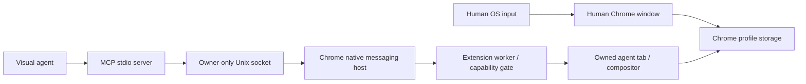

# Architecture: visual capability lanes

The ownership unit is an interaction surface, not a macOS keyboard or a copy of a
user's credentials. A lane is a dedicated normal Chrome window in the existing
profile. Each connected MCP process gets one host-assigned session and one owned tab.

## Lifecycle

1. Human loads the extension, registers its exact origin with the native host and
   approves starting origins through the popup. Setup creates a separate unfocused
   window containing an anchor. No automatic Chrome restart or launch-flag change.
2. A native port starts `src/native-host.js`. It creates a 0700 directory and 0600
   Unix socket. It refuses an existing socket instead of stealing another profile's
   connection. Chrome's host manifest allows only the installed extension ID.
3. Each socket gets a random session ID assigned by the host. Caller-supplied IDs
   are overwritten. The MCP toolset has no target enumeration/selection primitive.
4. `open` creates an inactive blank tab in the lane, attaches the debugger, enables
   Page, file-chooser interception, a fixed DPR=1 viewport and focus emulation. It
   selects only that owned tab inside the agent window, then navigates it.
5. A FIFO stages commands for all sessions. Before actions, window focus/state and
   current tab membership are checked. No windows are created during task execution.
6. Screenshots return actual Page.captureScreenshot PNGs plus a single-use random
   frame token. Input requires that token; navigation events invalidate it. There
   is no atomic screenshot/input lock on dynamic websites; tokens detect reuse and
   observed navigation, not every possible visual change.
7. Close/disconnect removes only the owned tab, after rechecking membership. A queued
   disconnected session is marked cancelled immediately, preventing queued mutations.
   An action already delivered to Chrome cannot be rolled back.

## Public API mapping

| Agent operation | Browser primitive |
|---|---|
| screenshot | Page.captureScreenshot, fromSurface=true |
| coordinate click | Input.dispatchMouseEvent move/press/release |
| text | Input.insertText; no clipboard mutation |
| scroll | Input.dispatchMouseEvent mouseWheel |
| allowed key | Input.dispatchKeyEvent down/up |
| navigation | Page.navigate |
| owned surface creation | chrome.tabs.create in the prepared window |

`Tab` is deliberately absent: when renderer focus traversal reaches browser chrome,
our headed fixture observed window focus transfer. Enter, Escape, Backspace and arrows
are exposed; they are not proven safe under every page behavior. Browser shortcuts,
arbitrary Runtime/Network/Storage/Target commands and human-tab IDs are absent.
The extension itself necessarily holds broad debugger authority: it is trusted code,
not a Chrome-enforced least-privilege sandbox.

## Failures and recovery

A focused or minimized lane is refused. A moved tab loses ownership and is detached,
never closed in its new window. A user-cancelled debugger requires session recreation. A target_closed detach can
reattach only after validating that the exact owned tab still exists in its lane;
Chrome-prohibited extension URLs are never bypassed.
Each CDP command has a 10-second deadline. Timeout poisons the lane and detaches the
target; new actions require human reload/setup. The queue is not simply released to
continue mutating after an uncertain in-flight command. The bridge deadline is 30 s.
Malformed/oversized messages are bounded; outbound native messages are under 1 MiB,
inbound native responses under 16 MiB, socket requests under 64 KiB.

Worker restart intentionally does not adopt tabs from storage: a mistaken adoption
could capture a human tab. Old tabs/anchor windows may remain for manual cleanup.
A crash can leave a socket; after confirming its host process is gone, remove only
that stale socket. There is no silent profile fallback or automatic focus repair.

## Boundaries still missing

Profile storage, cookies, service workers, permissions and server-side account state
are shared. A site can change another tab through shared state or its application
backend. Browser-created popups, native permission UI, security interstitials and
OS authentication sheets are outside this renderer lane. Dismissing JS dialogs
through CDP reduces one failure mode, but does not prove they cannot activate a
window before that event is handled. Popups are not controlled or adopted in v0.1.

Strict general isolation needs a Chrome-owned target class whose browser UI cannot
activate a desktop window, whose popup descendants inherit ownership, and whose
modal surfaces are rendered into the lane. Such a change should live upstream;
after-the-fact focus restoration is interference and is not an acceptable substitute.
