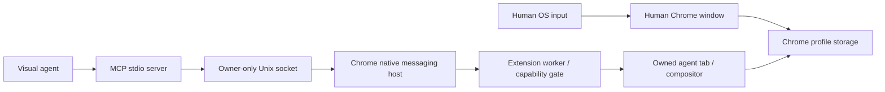

# Architecture: visual capability lanes

The ownership unit is an interaction surface, not a macOS keyboard or a copy of a
user's credentials. A lane is a dedicated normal Chrome window in the existing
profile. Each adapter gets one host-assigned logical session and one owned tab. In 0.2.0,
opt-in capability files preserve that session across adapter/native-host restarts
while the extension retains its original capability. See [coordination](COORDINATION.md).

## Lifecycle

1. Human installs the recommended Chrome Web Store extension or an optional manual
   copy, registers that copy’s exact origin with the native host (the store origin is
   `chrome-extension://mpiigaljakpfmmihkahppdaaccmpgmmk/`) and
   chooses Selected websites (default) or explicit Any website through the popup.
   Selected websites checks direct opening and navigation against exact origins;
   links and redirects can lead elsewhere. Setup creates a separate unfocused
   window containing an anchor. No automatic Chrome restart or launch-flag change.
2. A native port starts `src/native-host.js`. It creates a 0700 directory and 0600
   Unix socket, then sends a readiness handshake. Setup reports a connection only
   after that handshake; failed connection attempts can reuse the same lane window.
   It refuses an existing socket instead of stealing another profile's
   connection. Chrome's host manifest allows only the installed extension ID.
3. Each socket gets a host-assigned random session ID. Persistent sessions prove a
   private capability bound to a browser environment; one live socket lease is allowed.
   Caller-supplied session/tab IDs are ignored. MCP cannot enumerate/select targets.
4. `open` creates an inactive blank tab in the lane, attaches the debugger, enables
   Page, file-chooser interception, a fixed DPR=1 viewport and focus emulation. It
   navigates the inactive tab; screenshot capture stages it later.
5. Bounded per-owner FIFOs order operations. Independent renderer input/navigation
   can overlap; screenshots and tab creation/closure share a mutex. Already-active
   tabs need no selection edit. Explicit Chrome tab-drag edit refusals wait boundedly.
   Every debugger dispatch rechecks ownership, cancellation, control/focus generations
   and window state. No windows are created during task execution.
6. Capture tracks navigation revisions and waits 150 ms for late navigation events.
   If navigation spans capture/settling, it recaptures, up to eight attempts; ongoing
   navigation returns an observation error instead of granting a token. The returned
   metadata includes revision and capture attempt count, without page URLs or content.
   Screenshots return actual Page.captureScreenshot PNGs plus a single-use random
   frame token. Input requires that token; navigation events invalidate it. There
   is no atomic screenshot/input lock on dynamic websites; tokens detect reuse and
   observed navigation, not every possible visual change.
7. Close removes only a validated owned tab. Default disconnect cancels and cleans
   up; persistent disconnect fences and retains the original capability. Human-
   controlled tabs survive disconnect. An already-delivered action cannot be rolled
   back. Explicit human handback requires a fresh screenshot.

## Public API mapping

| Agent operation | Browser primitive |
|---|---|
| screenshot | Page.captureScreenshot, fromSurface=true |
| coordinate click | Input.dispatchMouseEvent move/press/release |
| text | Input.insertText; no clipboard mutation |
| scroll | Input.dispatchMouseEvent mouseWheel |
| allowed key | Input.dispatchKeyEvent down/up |
| navigation | Page.navigate |
| owned surface creation | chrome.tabs.create in the prepared window |

`Tab` is deliberately absent: when renderer focus traversal reaches browser chrome,
our headed fixture observed window focus transfer. Enter, Escape, Backspace and arrows
are exposed; they are not proven safe under every page behavior. Browser shortcuts,
arbitrary Runtime/Network/Storage/Target commands and human-tab IDs are absent.
The extension itself necessarily holds broad debugger authority: it is trusted code,
not a Chrome-enforced least-privilege sandbox.

## Failures and recovery

A focused or minimized lane is refused. A moved tab loses ownership and is detached,
never closed in its new window. A user-cancelled debugger requires session recreation. A target_closed detach can
reattach only after validating that the exact owned tab still exists in its lane;
Chrome-prohibited extension URLs are never bypassed.
Each CDP command has a 10-second deadline. Timeout fences its owner and detaches only
a still-current capability; independent sessions remain usable. The affected owner
requires explicit cleanup/recreation. The queue is not simply released to
continue mutating after an uncertain in-flight command. Only a transient inactive-page capture is retried, for up to eight read-only
   attempts. Clicks, typing and navigation are never automatically repeated.
   The bridge deadline is 30 s.
Malformed/oversized messages are bounded; outbound native messages are under 1 MiB,
inbound native responses under 16 MiB, socket requests under 64 KiB.

The local `startingPolicy` stores `{ mode: 'selected' | 'any', websites: [...] }`.
A truly absent configuration prefills selected Google. Legacy `websites`/`origins`
lists remain selected; empty or malformed data yields an empty selected policy
requiring correction. Any website is enabled only by an explicit `any` mode, never
by an empty list or wildcard. Both `open` and `navigate` use the same HTTP(S),
credential and policy validation. Only the setup page can save policy, and active
sessions prevent changes. Settings are saved even if the bridge connection fails.

Worker restart intentionally does not adopt tabs from storage: a mistaken adoption
could capture a human tab. Old tabs/anchor windows may remain for manual cleanup.
A crash can leave a socket. A kernel-held SQLite lock serializes current-host
startup/reclamation and releases on process death; a live legacy socket is preserved.
Corrupt/unknown journal schemas fail closed. There is no silent profile fallback or automatic focus repair.

The MCP client checks its actual socket rather than a one-time connected flag. If
the bridge is absent, later calls retry connecting; if it disconnects, a later call
can connect to a replacement host without restarting MCP. A broken in-flight call
returns an unknown-outcome error and is never replayed. Default connections receive new identities and require a fresh owned tab. Opt-in
logical sessions call `lane_open` to reconcile their surviving capability without
navigating the supplied URL. Missing worker/Chrome capability state fails explicitly.
On native-port loss persistent owners are suspended; default owners are cancelled.
Interrupted journalled mutations are not replayed.

Removing the prepared window immediately revokes its session map and frame tokens.
Recreating it through the setup panel establishes a new generation. Queued work,
in-flight command continuations, asynchronous window checks and late timeouts from
the previous generation cannot act on or poison the replacement. Starting policy
persists. No window enumeration/adoption or automatic focus repair is added to MCP;
only the human's extension setup creates the replacement window. Merely opening
`anchor.html` does not create a browser bridge.

## Select picker presentation

A native HTML select menu can change macOS window ordering while Chrome still
reports the lane window as unfocused. The focus guard alone cannot detect that
transition. Owned targets now install a fixed isolated-world script before document
scripts, opting ordinary single-select controls into
[Chrome's in-page select picker](https://developer.chrome.com/blog/a-customizable-select).
Original nodes, options, values and trusted input/change events remain intact.
Only control presentation changes; page values are never read back through this helper.

The bootstrap handles dynamically inserted selects, navigations and open shadow
roots. It leaves multiple/size>1 listboxes alone. Cross-process child iframes use
[Chrome debugger flat sessions](https://developer.chrome.com/docs/extensions/reference/api/debugger#attach-to-related-targets):
only iframe children of an owned tab are attached, recursively prepared, then resumed.
These session identifiers remain internal. Human tabs and new popup tabs are never
adopted. Pending frame setup must complete before further lane input.

Browsers lacking base-select support fail before task navigation. A capture-phase
guard blocks native select activation if computed picker styles conflict and reports
a fixed failure through an isolated-world binding. No focus restoration is attempted.
Other native controls and closed shadow-root pickers are outside the verified fix.

## Boundaries still missing

Profile storage, cookies, service workers, permissions and server-side account state
are shared. A site can change another tab through shared state or its application
backend. Browser-created popups, native permission UI, security interstitials and
OS authentication sheets are outside this renderer lane. Dismissing JS dialogs
through CDP reduces one failure mode, but does not prove they cannot activate a
window before that event is handled. Popups are not controlled or adopted in v0.1.

Strict general isolation needs a Chrome-owned target class whose browser UI cannot
activate a desktop window, whose popup descendants inherit ownership, and whose
modal surfaces are rendered into the lane. Such a change should live upstream;
after-the-fact focus restoration is interference and is not an acceptable substitute.

The setup popup updates from lifecycle events without a polling interval. Only its
trusted extension-origin sender can change access or pause/resume/release an owner.
Human takeover fences work before reporting readiness. The popup displays owned
session titles, never enumerating human tabs. Starting policy changes still require
no active sessions. See [coordination](COORDINATION.md) for exact guarantees and limits.
