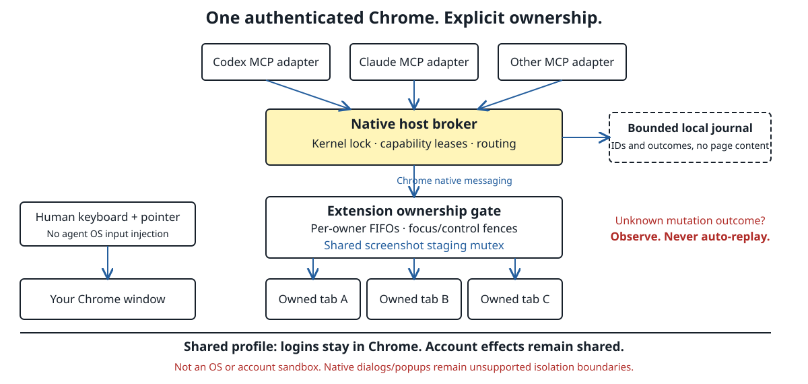
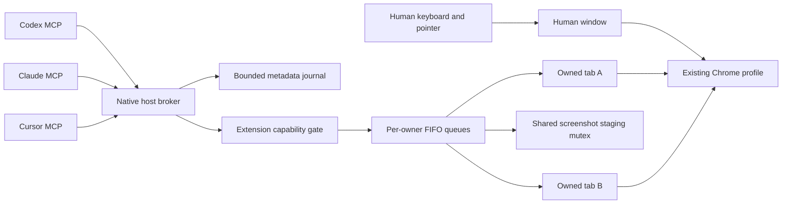
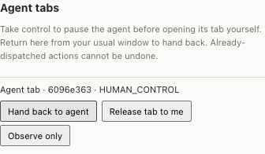

# Coordination and recovery in 0.2.0 source

This is unreleased source. The store's verified 0.1.1 package does not contain these
extension changes. Use a manual source build in a disposable profile for validation.
The local broker requires Node.js 22.13+. Do not replace a personal installation
merely to run tests.



## One broker, explicit browser capabilities

The Chrome-launched native host remains the local broker. A kernel-held SQLite
transaction elects one host for a state directory. The lock dies with the process;
there is no heartbeat or PID-based lock takeover. Socket cleanup compares the
original inode. A live older host is still protected by a socket probe.

MCP callers never choose tab IDs or logical session IDs. The host supplies routing
identities; the extension owns the browser capabilities. Every debugger command
checks cancellation, control generation, window state and current tab membership.
A tab move event revokes ownership even if the human moves the tab back later.



Renderer-targeted input and navigation on independent tabs can overlap. Screenshot
capture, opening and closing share a FIFO mutex because the lane window has one
selected-tab surface. This is not parallel screenshot capture. Each client has one
in-flight socket request; host clients/pending requests are capped at 64, adapter and
lane queues at 128. Chrome can impose a profile-wide tab edit lock during dragging;
only its explicit pre-dispatch refusal is retried, boundedly.

## Optional logical sessions across MCP/native-host restarts

Without configuration, disconnect attempts to close the session's owned tab. If the
lane is human-focused, minimized or human-controlled, cleanup is refused and the tab
is retained for explicit release. A transport disconnect never authorizes focus recovery.

Create a separate private capability file for each logical agent:

```sh
node scripts/create-session.mjs "$HOME/.agentlane/sessions/research.json"
```

Set `AGENTLANE_SESSION_FILE` in that MCP server's environment to the absolute file
path. For example, add this to its existing Codex MCP configuration:

```toml
[mcp_servers.agentlane.env]
AGENTLANE_SESSION_FILE = "/absolute/path/to/.agentlane/sessions/research.json"
```

Use distinct files for simultaneous logical agents, even in the same client product.
The file contains a local bearer capability, not website credentials. Keep it private;
do not commit it. The broker stores only its hash, host-assigned client/session IDs,
a browser-environment binding and whether browser work was opened. At most 256
persistent identities are accepted. The file is never overwritten by the creator.

Chrome-local storage holds a random environment ID, specific to this extension
installation/profile. The broker connection also gets a fresh generation each start.
A live socket lease prevents two adapters from controlling one logical session.
Knowing a session ID is insufficient; reconnect requires its capability file.
This does not sandbox another process running as the same OS user that can read files.

On persistent disconnect, the extension immediately fences work and invalidates frames,
retaining the exact in-memory tab capability. Reconnect with the same file and call
`lane_open`. If that capability survives, the result says `recovered: true`,
`opened: false`, and `observationRequired: true`. The supplied URL is not navigated.
Take a new screenshot before input. A conflicting live client gets `SESSION_IN_USE`.

If the worker or Chrome lost the capability registry, recovery fails closed with
`SESSION_RECOVERY_FAILED`. No tab is adopted from disk IDs, titles or URLs. After
reviewing the loss, `lane_close` acknowledges/reset the logical session; a later
`lane_open` can create a fresh tab. A fresh tab is not described as recovered. Old
orphan tabs may remain for manual cleanup. Browser/worker restart restoration is
not implemented; only MCP/native-host survival while the worker retains ownership
has been demonstrated. A changed page is observed as it is, never restored by URL.

## Operations, cancellation and unknown outcomes

The local journal contains at most 4,096 recent records: opaque IDs, operation name,
timestamp and state. No URLs, arguments, screenshot data, input text or website
responses are stored. Schema changes are transactional. Corrupt or unknown schemas
fail closed. Startup converts interrupted dispatches to `OUTCOME_UNKNOWN` (interrupted
read-only screenshots to `FAILED`). It never replays them.

```mermaid
stateDiagram-v2
  [*] --> QUEUED
  QUEUED --> RUNNING: durable record before forwarding
  RUNNING --> COMPLETED: browser acknowledgement
  RUNNING --> FAILED: confirmed rejection
  RUNNING --> OUTCOME_UNKNOWN: lost acknowledgement or interrupted mutation
  OUTCOME_UNKNOWN --> [*]: observe and explicitly decide; never auto-replay
```

`COMPLETED` means Chrome acknowledged the command sequence, not that a website saved
or committed. Browser dispatch, browser acknowledgement and website effect are three
different observations. A recorded operation ID is never replayed within the bounded
retention window; this is not an unlimited deduplication or exactly-once guarantee.
Screenshots can be recaptured; clicks, text, keys and navigation are not automatically
repeated. MCP cancellation before dispatch is safe; after dispatch it is uncertain
and fences the socket/session. Cancellation is not rollback.

The 0.2.0 extension requires disclosure version 2 before normal setup and enables
journal retention through its handshake. Legacy extensions remain usable without
new journal retention (`coordination.journal: false`); persistent sessions require
the updated extension. Upgrading the checkout does not reload an installed extension.

New adapters negotiate bridge protocol compatibility before dispatch. An older native
host returns `BROWSER_BRIDGE_UPGRADE_REQUIRED` without sending a browser action; restart
the native bridge and MCP process after updating source. With journalling enabled,
errors identify the journal operation ID with `operationIdSource: "journal"`. Inspect
one record locally with `node scripts/operation-status.mjs <journal-operation-id>`.
This read-only diagnostic is not proof of a website effect and never retries work.

## Human control and observation-only access

When an agent asks for MFA/CAPTCHA or another human action, open AgentLane's popup.
The agent must not solve the challenge or focus its window as a workaround.

1. Find the exact agent tab by its displayed title and short session label.
2. Choose **Take control**. `HANDOFF_PENDING` fences new and queued operations and
   waits for the bounded current operation to stop. Wait for **HUMAN_CONTROL**.
   Already-dispatched effects cannot be undone; inspect the page before acting.
3. Open the tab yourself and complete the human interaction.
4. Return to your usual window and choose **Hand back to agent**. Focus/minimization
   and ownership checks run again. A new screenshot is required. The agent cannot
   infer handback from changed page content.
5. Alternatively choose **Release tab to me**. Debugger ownership is detached and
   removed; the actual tab survives. It cannot later be reclaimed by URL.

**Observe only** denies every input and navigation method for that session in trusted
extension code. A queued operation is fenced when the policy changes. It allows
screenshots and closing an agent-controlled owned tab. Legacy sessions default to
interaction for compatibility. It is not a semantic “safe clicks only” classifier:
all clicks/typing/keys can cause external effects, so all are denied in observation
mode. Restrictions survive close/reopen within a logical session and are stored
as Chrome-local policy metadata. Agent arguments and page content cannot change them.
The popup updates from lifecycle events; there is no health-polling timer.



*Actual 0.2.0 source UI from the disposable setup test; synthetic page only.*

## Limits and verification

Selected websites remains an exact-origin restriction on direct open/navigation,
not on redirects, links, subframes or network traffic. Shared authentication means
shared account authority and server effects. No raw JS, cookie, storage or header
extraction interface has been added. There is no tab sharing or ownership transfer
between agents. Popups/native dialogs can still activate browser UI before an event
handler can respond. General zero-interference on arbitrary sites is not achievable
with this extension layer; unsupported boundaries must be reported.

```sh
npm test
node experiments/setup.mjs
node experiments/dropdown.mjs
AGENTLANE_MCP=1 AGENTLANE_NAVIGATION_PROBE=1 npm run test:browser
node experiments/reliability.mjs
node experiments/recovery.mjs
```

These use synthetic data/disposable profiles. Reliability tests cover 1/2/5/10/20
real MCP clients, exact distinct server submissions, human selected-tab/input
preservation and resource cleanup. Recovery injects a native-host loss after a real
server effect and before its acknowledgement. Worker-registry loss is a simulation,
not a claim of actual worker restart recovery. Physical concurrency, real-account
compatibility and comparative baselines need separate evidence. See EVIDENCE.md and
benchmark documentation for measured results and omissions.
