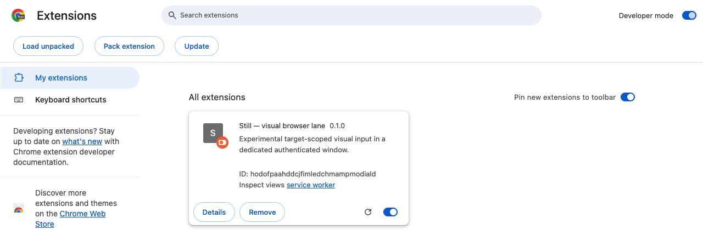

# Manual install: latest repository changes

The [Chrome Web Store version](STORE-SETUP.md) is recommended for routine use.
A manual unpacked installation lets you try repository changes before a store
release. Those changes may not have completed Chrome Web Store review and can be
less stable. Manual installs do not update automatically.

Both options require macOS, Chrome 134+, Node.js 22+, the local native bridge and
an MCP client. Installing the extension alone is not enough.

## Download and load

1. [Download the main-branch ZIP](https://github.com/orkunkinay/AgentLane/archive/refs/heads/main.zip)
   and extract it, or clone the repository. Keep the extracted checkout in a permanent
   location: Chrome, the native launcher and MCP configuration refer to its files.
2. In a terminal in the checkout root, run `npm ci` and `npm test`.
3. In the Chrome profile you want to use, open `chrome://extensions`, turn on
   **Developer mode**, choose **Load unpacked**, and select the checkout's
   **`extension/` folder**, not its root.
4. Copy the 32-character ID on the AgentLane card. Use this ID for the local bridge;
   **do not use the store ID** for a manually loaded copy.



*Disposable-profile screenshot. Copy your own ID, not the example in this image.*

Review Chrome's broad debugger permission and the screenshot/input disclosure.
Screenshots and typed input can reach your MCP client and AI provider. The
[security model](../SECURITY.md) and [privacy policy](https://orkunkinay.github.io/AgentLane/privacy/)
apply to both installation routes.

## Connect the local bridge

For a fresh installation, from the checkout root:

```sh
node scripts/install-host.mjs YOUR_32_CHARACTER_EXTENSION_ID
npm run doctor
```

Replace the placeholder with the manual extension's actual ID. Then follow
[store setup steps 3 and 4](STORE-SETUP.md#3-create-and-connect-the-workspace) to
accept the disclosure, create the workspace and configure your MCP client. The
workspace and agent setup are the same for both routes.

## Switching between store and manual installs

Finish active tasks first and check that no other Chrome profile depends on the
existing host registration. Disable the copy you are leaving; use only the intended
copy for the bridge. The installer refuses to overwrite an existing manifest.

Run `npm run doctor` and inspect the registration. After confirming that it belongs
to the installation being switched, preserve a backup and register the new copy:

```sh
AGENTLANE_MANIFEST="$HOME/Library/Application Support/Google/Chrome/NativeMessagingHosts/org.agentlane.browser.json"
cat "$AGENTLANE_MANIFEST"
mv -i "$AGENTLANE_MANIFEST" "$AGENTLANE_MANIFEST.before-switch"
node scripts/install-host.mjs YOUR_32_CHARACTER_EXTENSION_ID
npm run doctor
```

For manual installation, substitute the ID copied from its card. For a return to
the store version, substitute `mpiigaljakpfmmihkahppdaaccmpgmmk`. Keep exactly one
allowed origin. Do not broaden the allowlist, delete a live socket or stop another
profile's host. Finish its sessions before switching if a live host still owns the
socket. Retain the backup.

Open the intended extension, choose **Connect browser** or **Create agent window**,
and confirm **Connected**. Leave the workspace open, unminimized and unfocused.
If the checkout path changed, update your MCP entry to its new absolute paths.
Use a fresh `lane_open`; interrupted actions must not be replayed.

## Update a manual installation

1. Finish active sessions. Preserve any local edits before updating.
2. For a Git checkout, run `git pull --ff-only`, `npm ci` and `npm test` from its root.
   For a ZIP installation, download a fresh ZIP and update the existing permanent
   folder after preserving local edits. Keep the same folder path; selecting a new
   folder can change the unpacked extension ID and break bridge/MCP paths.
3. Open `chrome://extensions` and click **Reload** on the manually loaded AgentLane
   card. Confirm its ID still matches the native-host origin.
4. Restart the MCP server and reconnect the browser bridge so running processes load
   the updated local code. Create a fresh workspace if needed, confirm **Connected**,
   and request a fresh `lane_open`.

The store copy continues to update through Chrome and does not read extension code
from this checkout. A manual installation receives changes only when you update its
files and reload it.
