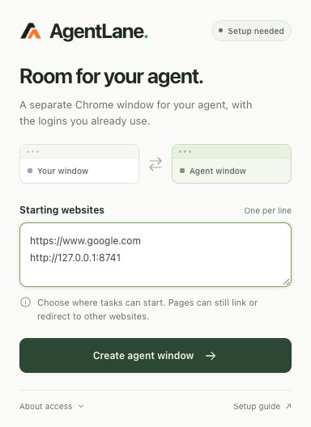
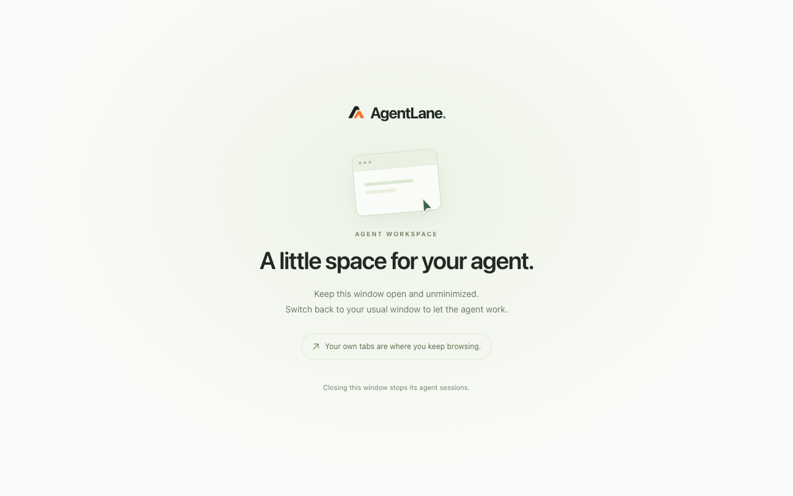
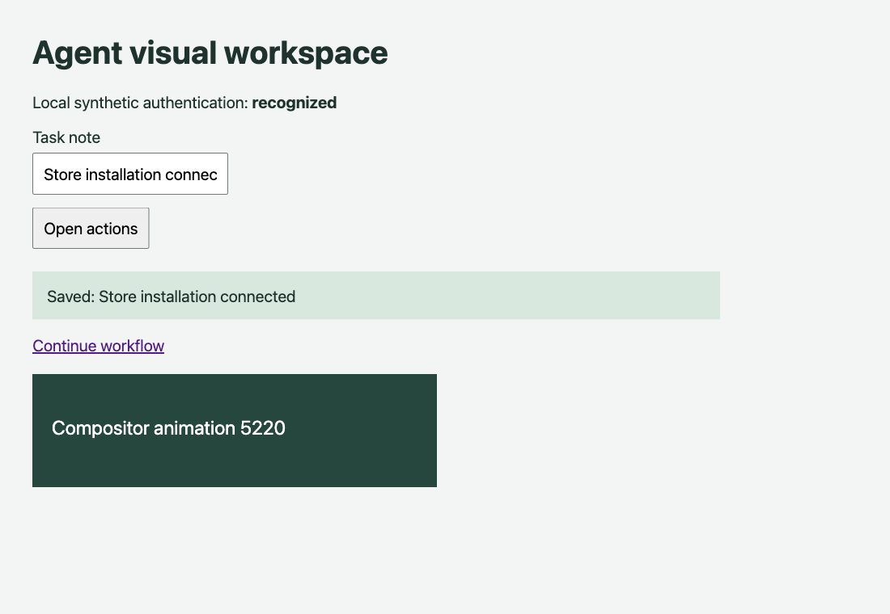

# Set up AgentLane from the Chrome Web Store

Use macOS, Google Chrome 134+ and Node.js 22+. The store download installs the
**extension only**. You also need the source checkout, local native bridge and an
MCP client on the same Mac. Keep the checkout at its installed path.

Prefer repository changes before they reach the store? Use the optional
[manual installation and update guide](MANUAL-SETUP.md). It requires Developer mode,
its own extension ID and manual updates; the local bridge/MCP requirements remain.

## 1. Install the extension

In the Chrome profile where you normally browse and sign in, open
[AgentLane in the Chrome Web Store](https://chromewebstore.google.com/detail/agentlane/mpiigaljakpfmmihkahppdaaccmpgmmk).
Choose **Add to Chrome**, review the permission prompt, and install. If the button
already says **Remove from Chrome**, it is installed. Open Chrome's puzzle-piece
extensions menu and pin AgentLane if you want its icon in the toolbar.

Developer mode and Load unpacked are unnecessary for the store version. Its ID is:

```text
mpiigaljakpfmmihkahppdaaccmpgmmk
```

Chrome grants broad debugger permission, although AgentLane exposes only eight
restricted tools. Screenshots and typed input can reach your configured MCP client
and AI provider. Review the [security model](../SECURITY.md) and
[privacy policy](https://orkunkinay.github.io/AgentLane/privacy/).

## 2. Install the local bridge

In a terminal:

```sh
git clone https://github.com/orkunkinay/AgentLane.git
cd AgentLane
npm ci
npm test
node scripts/install-host.mjs mpiigaljakpfmmihkahppdaaccmpgmmk
npm run doctor
```

If you already have the checkout, use it instead of cloning again. If the installer
reports **Manifest exists**, follow the migration section below before retrying.
The diagnostic should show the exact store origin. A bridge-not-running warning is
expected until you connect through the extension in the next step.

## 3. Create and connect the workspace

Open AgentLane using its toolbar icon or Chrome's extensions menu.

1. Keep **Selected websites**, which defaults to `https://www.google.com`, and add
   any starting websites you need. For the synthetic demo below, also add
   `http://127.0.0.1:8741`. **Any website** explicitly permits direct HTTP(S) navigation.
2. Read and affirm the screenshot/input disclosure. Its checkbox is hidden if you
   have already accepted the current disclosure.
3. Click **Create agent window**. If a workspace exists but the bridge is disconnected,
   the button may instead say **Connect browser**.
4. Wait for **Connected**. Leave the workspace open and unminimized, then return to
   your usual Chrome window. **Paused** means the lane is focused or minimized.



*Setup UI captured in a disposable Chrome for Testing profile with example websites.
The same setup controls are used by the store extension.*



*Disposable-profile UI capture. A workspace window alone does not prove the local
bridge is connected; check the popup and `npm run doctor`.*

Selected websites checks the exact protocol, host and port for direct opening and
navigation. Links and redirects can lead elsewhere. `localhost` and `127.0.0.1`
are different origins.

## 4. Connect your MCP client

From the checkout root, for Codex:

```sh
AGENTLANE_NODE="$(node -p 'process.execPath')"
AGENTLANE_PROJECT="$(pwd)"
codex mcp add agentlane -- "$AGENTLANE_NODE" "$AGENTLANE_PROJECT/src/mcp.js"
codex mcp get agentlane
node scripts/install-skill.mjs
```

If an entry or skill already exists, inspect it instead of adding or overwriting it.
The server should be enabled and point at this checkout's `src/mcp.js`. For Claude
Code or another stdio MCP client, follow [Connect an agent](https://orkunkinay.github.io/AgentLane/docs/#connect).
Start a fresh conversation after first-time MCP registration so the tools appear.
An already-configured conversation can reconnect after bridge repair with a fresh
`lane_open`; interrupted input is never replayed.

## Verify with a synthetic task

Start the included local demo server and leave it running:

```sh
node scripts/demo-server.mjs
```

Visit `http://127.0.0.1:8741/seed` in your usual Chrome window to establish a
synthetic localhost session. With that origin allowed in the extension, ask:

```text
Use the agentlane-browser skill and AgentLane lane tools only.
Open http://127.0.0.1:8741/task. Confirm the synthetic session is recognized.
Enter “Store installation connected”, open Actions and save the note.
Verify the saved result from a screenshot, then close your owned tab.
```



*Actual `lane_screenshot` capture using store extension 0.1.1 on 2026-11-18 after
repairing the bridge registration. Only synthetic local demo content is shown.
This verifies navigation, screenshot, click, typing and saving; it is not a physical
concurrency measurement or a guarantee for arbitrary sites. Stop the demo server
with Ctrl+C when finished.*

## Switching from an unpacked extension

**Removing the old extension does not remove or update the native host manifest.**
An unpacked copy and the store copy have different IDs. A registration that still
allows the old ID prevents the store copy from connecting, even if its workspace
window opens. This was the setup failure reproduced and repaired on 2026-11-18.

1. Finish active AgentLane tasks. Check that no other Chrome profile depends on the
   old registration. Do not terminate another profile's host or delete its socket.
2. Run `npm run doctor`. Compare its `allows only chrome-extension://…/` line with
   `chrome-extension://mpiigaljakpfmmihkahppdaaccmpgmmk/`.
3. If it shows the old unpacked ID, inspect the manifest below. Back it up and replace
   its registration only after confirming it belongs to the installation being migrated.

```sh
AGENTLANE_MANIFEST="$HOME/Library/Application Support/Google/Chrome/NativeMessagingHosts/org.agentlane.browser.json"
cat "$AGENTLANE_MANIFEST"
# Proceed only after the ownership/session checks above; keep the backup.
mv -i "$AGENTLANE_MANIFEST" "$AGENTLANE_MANIFEST.before-store"
node scripts/install-host.mjs mpiigaljakpfmmihkahppdaaccmpgmmk
npm run doctor
```

Do not add both IDs or a wildcard. If a live host owns the socket, leave it intact
and finish its sessions before migrating. The installer refreshes the local launcher,
so run it from the checkout you intend to keep.

Open the store extension and choose **Connect browser** or **Create agent window**.
Confirm **Connected**, run `npm run doctor` again, and request a fresh `lane_open`.
A reinstall of the store extension or a new conversation alone cannot repair an
old native-host ID. Routine repair does not require deleting Chrome profile data.

## If setup still fails

- **No native host manifest:** run the bridge installer with the store ID.
- **Manifest exists:** use the reviewed migration above; the installer deliberately
  refuses to overwrite an existing registration.
- **Connected but lane paused:** restore it manually if minimized and return to your
  usual window. The agent must not focus or restore its lane to recover.
- **No lane tools:** verify MCP configuration and start a fresh conversation with
  AgentLane enabled.
- **Store page cannot open through AgentLane:** Chrome refused direct Web Store
  navigation with `Page.navigate: Not allowed` in this verification. Install and
  manage extensions manually in your normal browser; test AgentLane on an ordinary
  allowed HTTP(S) page.

See [troubleshooting](TROUBLESHOOTING.md) for Node paths, moved checkouts, live-host
conflicts and connection recovery.
